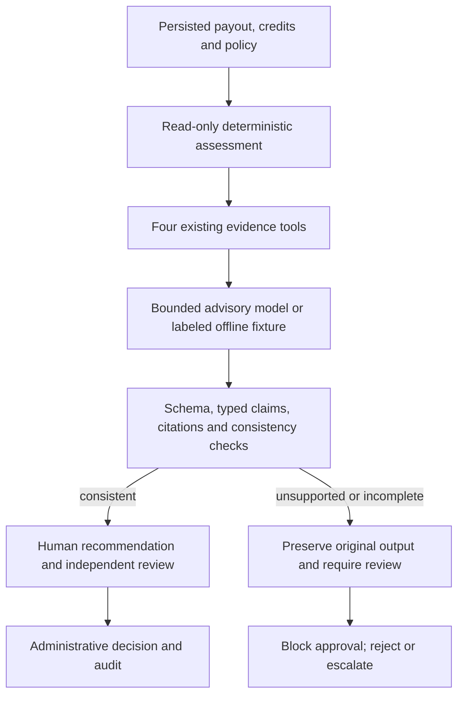

# Controlled AI Investigation v2

**IMPLEMENTED · OFFLINE VERIFIED · LIVE V2 QUALITY NOT MEASURED.** This milestone strengthens
how ReconFlow investigates a deterministic finding. It does not replace reconciliation, approve
funds or rebuild the application. New jobs are versioned `controlled-investigator-v2`; pre-existing
queued jobs and stored reports retain their legacy interpretation.

The [November 8 raw-evidence result](holdout-2026-11-08.md) remains **18/48 (37.5%)**, unchanged.
Its low score motivated stronger evidence and consistency gates; it has not been rewritten as a
v2 success or replaced by scripted outputs.

## What the pipeline does



Financial truth remains Python integer-minor-unit arithmetic and the persisted reconciliation
record. V2 computes a read-only assessment; it never rewrites a Match, payment, payout or bank credit.

## Deterministic evidence before the model

The existing tool names are reused: case, payout/payment aggregates, candidate credits and provider
policy. The payout tool additionally carries `controlled_findings` with typed facts and provenance.

| Evidence | Deterministic computation / rule |
| --- | --- |
| Fee | Expected half-up fee from gross and basis points; observed fee and difference |
| Gross to net | Gross − refunds − observed fee + adjustment; declared/component difference |
| Bank amount | Same-currency credit/component-net difference in integer minor units |
| Currency | Explicit mismatch; amounts in different currencies are never subtracted |
| Timing | UTC booking relative to the inclusive settlement-to-policy-window interval |
| Ambiguity | Multiple candidate credits or shared payout reference; no unique match invented |
| Missing facts | Absent/invalid required amounts, dates, policy or truncated candidate evidence |
| Conflicting records | Stored rule finding disagrees with the recomputed evidence; abstain/escalate |

All simultaneous findings are retained. The primary finding follows existing reconciliation
precedence; missing mandatory evidence or a conflicting stored record produces explicit abstention.
A credit before settlement is outside the same window and retains the legacy LATE_CREDIT label;
its signed seconds-after-settlement fact makes the direction visible.

## V2 report and consistency contract

Material facts use a **closed, typed claim contract**: `fact_id`, exact typed value and supporting
observed evidence IDs. Required claims must cover the material deterministic findings. Copying
an ID alone is insufficient: wrong values, wrong source relationships, missing coverage, or a
boolean substituted for an integer fail validation.

The financial summary is a canonical deterministic sentence that the model must copy exactly.
The agent selects/prioritizes verified claim references and safe follow-up; it is not allowed to
invent alternative financial prose. Hypotheses use a small context-appropriate catalog of tentative
possibilities and are displayed as **unverified**, never as facts. Missing-information identifiers,
abstention, classification, findings, follow-up action and human-review requirement are also checked.
This intentionally trades unrestricted narrative flexibility for testable financial consistency.

The adapter retains its existing JSON/tool-call transport and bounded request budget (four tools,
five HTTP requests, 1,200 completion tokens per request). JSON mode is not schema or semantic
assurance; server checks remain mandatory. See [official OpenAI documentation](https://developers.openai.com/api/docs/guides/structured-outputs?api-mode=chat).
No new agent framework, broker, model SDK or infrastructure is required.

## Failure and human-review behavior

A contradictory or unsupported parsed report is stored with its **original unmodified output**,
assessment and flags as `LIVE_REVIEW_REQUIRED`. It is not silently corrected into a successful AI
result. Provider/tool/malformed-JSON failures can have no structured original payload; their failure
category and available trace are retained without logging provider response bodies or credentials.
A completed worker job means processing finished, not that an AI report passed.

If no human proposal is pending, unsupported findings move the case to ESCALATED. A pending
proposal remains for its independent checker, with approval blocked. Ambiguous, incomplete,
conflicting or multiple-finding assessments also require escalation even if the report is consistent.

- Analysts investigate and submit recommendations; supervisors approve/reject/escalate another maker's proposal.
- An active investigation, latest failed report or mandatory-escalation assessment prevents approval.
- Auditors cannot mutate; a supervisor cannot decide their own proposal.
- Row locks refresh current state and serialize decisions; duplicate proposals/decisions are rejected.
- Approval only closes an administrative case. It never changes balances, matches or executes payments.
- The hash-chained audit and PostgreSQL mutation guard remain; a DB owner can still bypass guards.

## Two separate benchmarks

| Track | Task | Current observation |
| --- | --- | --- |
| A · raw-v1 | Infer a root cause from raw synthetic evidence, without rule findings | Historical live 18/48; all 30 failures remain public |
| B · controlled-v2 | Explain supplied deterministic findings using checked claims and safe recommendations | Offline harness only; live classification/support/latency/cost quality NOT MEASURED |

Track B uses `controlled-synthetic-v2.0`: **120** seeded cases, **48 development / 72 holdout**,
with fresh IDs and varied VND/USD amounts, fee policies, refunds and signed adjustments. Families:
clean, fee, missing settlement, delayed, ambiguous, refund, adjustment, missing evidence,
contradictory records, simultaneous discrepancies, currency mismatch and early settlement.
Adversarial instructions are embedded as untrusted data in both splits. Grading labels/rubrics stay
outside model messages/tools; computed rule findings are deliberately provided in track B.

The dataset is reproducible and templated, not a blinded sample of real bank operations. Repository
reviewers can inspect the generator; the model has no file/SQL/HTTP tool to retrieve grading labels.
Track B classification measures compliance with supplied financial truth, not independent discovery;
its score is not directly comparable to raw-v1 accuracy.

## Actual checks and remaining measurements

**MEASURED SOFTWARE/HARNESS CHECK:** the disposable no-key Docker workflow passed synthetic import,
replay, simulated investigation, independent approval, kill switch and injected failure/retry.
PostgreSQL competing supervisor transactions committed exactly one decision; audit-chain/UPDATE
checks passed. Ruff and **83 automated tests** passed, including wrong claims, missing-evidence
abstention, unsafe recommendations, unauthorized/duplicate decisions, cached-state refresh and
worker recovery. Desktop/mobile browser checks passed for controlled reports and the dashboard. The v2 harness checked **72/72 scripted contracts** and **72/72 deterministic
reference outcomes**, with **zero provider calls/tokens**. This is not 100% AI accuracy.

**Production verification:** Evaluation #3 ran all 72 offline cases on source
`16f3ee433d5a434d4526f792ce43a1b90baa7989`, with the API key blanked:
72 valid scripted contracts, 72 deterministic reference outcomes, zero requests/tokens/cost.
The source-pinned result was synchronized locally for development. Live v2 quality remains
**NOT MEASURED**.

- [Offline-only summary](../assets/evaluation/controlled-v2-offline-summary.json)
- [Three scripted development examples](../assets/evaluation/controlled-v2-development-examples.json) — not model outputs
- [Versioned dataset manifest](../assets/evaluation/controlled-v2-manifest.json)
- [Signed-in evaluation dashboard](https://tcb.jackylenghia.com/ai/evaluation)

The harness can measure accepted versus raw classification, typed-claim support/unsupported rate,
structured contradictions, appropriate abstention/escalation, per-category failures, token usage,
latency and configured-rate cost per investigation. Schema-invalid reports remain failures and
have unassessed claim/contradiction quality rather than an assumed zero error rate.
The unsupported-claim rate covers typed claim values and source relationships. Canonical-summary,
hypothesis and action failures are separate flags. Structured contradictions mean a differing
classification/finding set or typed fact value, not a complete semantic grading of arbitrary prose.

**NOT MEASURED:** live v2 model quality, independent source authenticity, calibrated confidence,
broad unrestricted-prose factuality, bank-risk safety rates, or human productivity improvement.
Existing business-case projections remain labeled assumptions; no productivity uplift is claimed here.

## Run the offline harness

```sh
make eval-v2
# Equivalent; --live is absent, so no configured provider is called:
docker compose run --rm app python -m reconflow.cli eval --track controlled-v2
```

Baseline `make eval` remains raw-v1 offline contract checking. Explicit paid v2 evaluation requires
a separate authorization and `--live --track controlled-v2`; none was run for this milestone.
Recommended next step: a small authorized development-set pilot and independent expert review of
rubric adequacy, followed by a frozen live holdout only after the contract is fit for purpose.
A useful no-key demonstration is to inject a contradictory mocked claim, show its retained output,
then show supervisor approval blocked and escalation recorded.

## Live evaluation preparation · awaiting operator authorization

**No paid v2 evaluation has started.** The audited runner now supports an explicitly selected
48-case development split and unchanged frozen 72-case holdout. A proposed 12-case development
pilot takes one example from each family: six VND and six USD payouts, six with adversarial
notes and six without. Labels and
reference rubrics remain outside adapter inputs/tools; supplied deterministic findings are
intentional in this benchmark. Dataset and prompt/schema hashes above remain frozen and are
checked before running. Results record the selected IDs/hash and split.

Before each paid request, an explicit operator `--max-cost-usd` bounds conservative configured-rate
reservations. This is an application estimate, not a provider billing guarantee. Unknown usage
stops further cases. Original malformed text, model messages, finish reasons, model IDs and usage
are retained alongside parsed reports, validation flags and separate provider/output/tool failure
categories. Invalid outputs never receive a deterministic replacement counted as AI success.

**PROPOSED, NOT RUN:** 12 development cases using `gpt-5.4-mini-2026-03-17`, USD 2 estimated-cost
reservation cap, no retries and at most 60 requests. Pilot review and separate authorization are
required before a single frozen 72-case holdout run. The runner blocks partial live holdouts and
repeat runs of the same frozen dataset. No live quality, cost, token or latency measurement is
inferred from this preparation. Historical raw-v1 and the earlier offline summary are unchanged.
