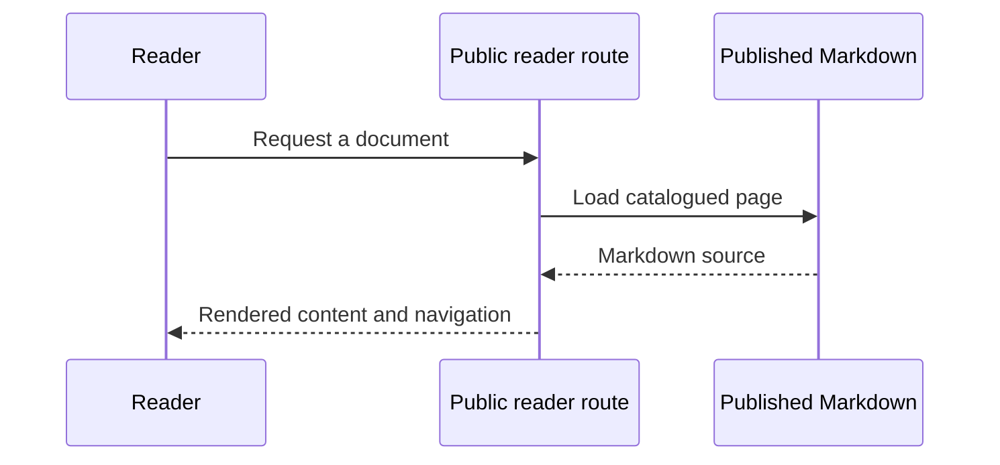

# Writing public documentation

Every non-hidden Markdown file inside `public-docs/` is intentionally public. Add a file and deploy
the application to publish it. The catalog discovers new pages and nested folders automatically.
Files elsewhere in the repository are not published by this reader.

## Pages, sections and links

Use a top-level heading as a page title. A folder's `index.md` is its section overview; deeper
folders appear as nested navigation. `navigation.json` optionally controls reading order, without
restricting which pages are discovered. New files not listed there still appear automatically.

Link to another page using normal relative Markdown links, for example
`[Architecture](../engineering/index.md)`. The renderer rewrites these to public document routes.
A [real cross-page heading link](../engineering/index.md#runtime-boundaries) demonstrates deep links.
Tables of contents and previous/next navigation are generated from the published content.

## Rich Markdown

The reader supports headings and anchors, **bold**, *emphasis*, ~~strikethrough~~, blockquotes,
nested lists, tables, task lists, fenced code with syntax highlighting, local images and footnotes.
Raw HTML is displayed as text rather than executed. Custom HTML embeds and remote scripts are
not supported.

| Feature | Example |
| --- | --- |
| Inline code | `expected_net` |
| A local link | [Product guide](../product/index.md) |
| Footnote | A dated assumption needs a source.[^source] |

- [x] Markdown renderer installed.
- [x] Public catalog and section navigation implemented.
- [ ] Independent accessibility certification (not performed).

```python
# Financial arithmetic remains deterministic.
expected_net = gross - refunds - fee + adjustment
```

## Mermaid diagrams

Use a fenced code block with the language `mermaid`. Diagrams render with a local Mermaid bundle
and strict security mode. Their text source remains available in an expandable panel, including
when JavaScript is disabled or rendering fails. Flowcharts, state diagrams and sequence diagrams
can describe different parts of the workflow.



The diagram is part of the document source, so edits are versioned with the explanation.
This rendering feature does not enable model tool calls or expose operations data.

## Publication checklist

1. Keep secrets, credentials, private server runbooks and real customer data out of `public-docs/`.
2. Preserve labels such as **MEASURED**, **ASSUMED**, **SIMULATED** and **PROPOSED**.
3. Run `uv run python -m scripts.check_public_docs` to validate all pages and local links.
4. Run the public docs browser checks when changing diagram/layout behavior.
5. Rebuild/deploy after editing the published source in the read-only application image.

This handbook is a reviewed public subset, not an automatic mirror of all internal `docs/` files.
When revising a shared decision or business assumption, update its public counterpart as well.

[^source]: This is a demonstration of a Markdown footnote, not evidence of a bank measurement.
