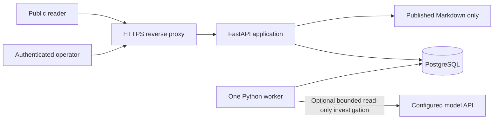
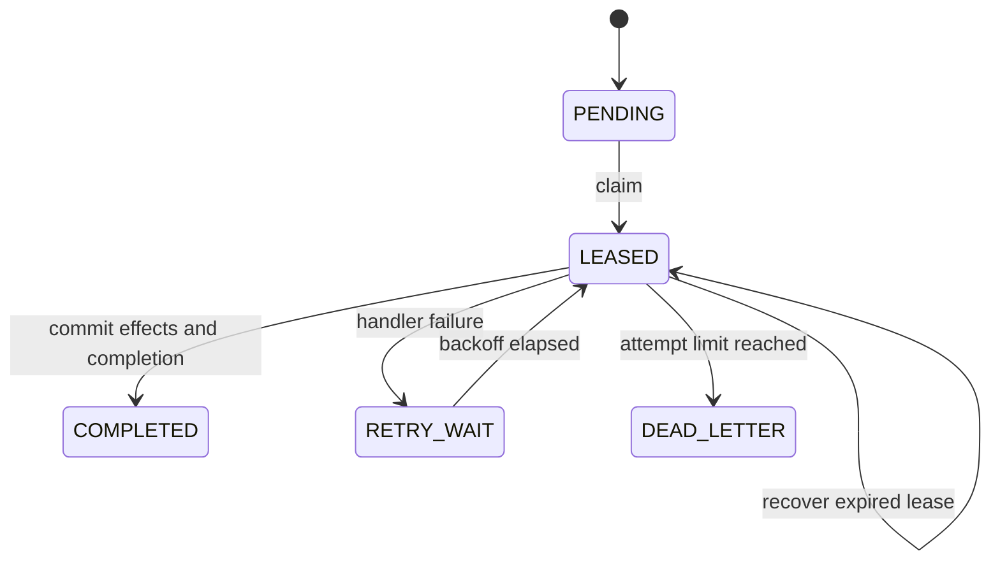

# Architecture

**IMPLEMENTED:** a Python-first FastAPI/Jinja2 modular monolith, PostgreSQL, a separate Python
worker, durable DB-backed jobs and a Caddy HTTPS reverse proxy. Assets are built and served locally.

## Runtime boundaries

The public documentation route reads a dedicated publication directory. Operations data and
mutating routes retain authenticated sessions and server-side role checks.

## Financial model

Payments are many-to-one with provider payouts. A payout can match a single eligible bank credit
under explicit reference, account, currency, amount and timing rules. Cumulative refunds are stored
on payment lines; provider fees and adjustments are stored on payouts. Separate refund ledgers,
partial settlement and complex many-to-many/cross-currency settlement are outside this MVP.

## Durable processing

The worker claims jobs using PostgreSQL row locks and `SKIP LOCKED`. Leases can expire and recover;
handler effects and completion commit atomically. Retries use bounded exponential backoff and a
three-attempt dead-letter state. A heartbeat and error history are visible in the console.

One worker is the supported target. This is not a claim that a distributed production queue fleet
has been load-tested. External model calls can repeat after a crash even when DB effects are safe
to retry; model HTTP calls are not exactly-once.

## Design decisions and limits

Read the [decision records](decisions/index.md) for the tradeoffs behind the modular monolith,
deterministic finance, synthetic sources and model choice. The [security boundary](security.md)
distinguishes implemented controls from the proposed production target.

The [development log](development-log.md) records actual requests, corrections and reflections from the build.

The [controlled-v2 investigation contract](../ai/controlled-v2.md) enriches existing read-only tools
and preserves flagged output; it leaves persisted reconciliation/finance records intact.
