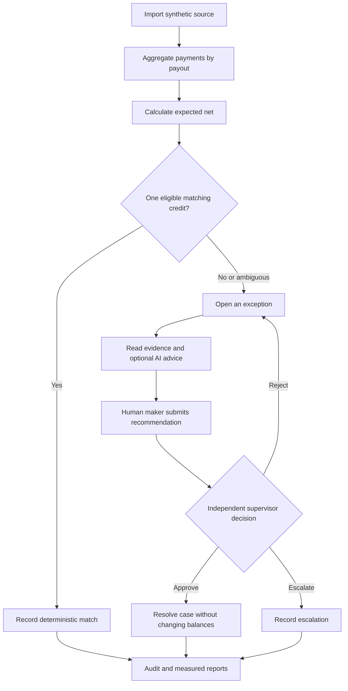

# End-to-end workflow

This walkthrough follows the [product guide](index.md). Financial arithmetic and matching are
deterministic; model explanations are advisory.

## From payment evidence to independent review



## Inspect the financial evidence

Start a 1,000-payment mismatch scenario in **Sources & imports**, then open its reconciliation run.
Inspect one payout's linked payments, cumulative refunds, fee, adjustment and candidate bank credits.

```python
expected_net = gross_payments - refunds - provider_fee + adjustment
```

The formula uses integer minor units. VND has exponent 0 and USD exponent 2. Amounts in different
currencies are never combined into one financial total. Ambiguous or unsupported settlement shapes
stay unresolved instead of receiving a forced match.

## Investigate and decide

Open an exception and review its evidence IDs. A queued investigation can produce **SIMULATED**
advice in no-key mode, **LIVE** output after a compatible configured model succeeds, or a clearly
labeled fallback. No live-model performance is established by the offline demonstration.

Submit an evidence-based human recommendation, then sign in as a different supervisor to approve,
reject or escalate. The maker cannot decide their own proposal. Approval closes the case; it does
not move money, change source records or execute an accounting adjustment.

## Verify the controls

- [ ] Replay the same original source and verify source/run/case counts are preserved.
- [ ] Inspect the injected failure scenario's first error and subsequent retry.
- [ ] Use the administrator's AI kill switch and confirm new investigations are stopped.
- [ ] Inspect the distinct actors and transitions in the audit history.

These are demonstration steps, not claims that a banking pilot or independent audit has occurred.
See [AI evaluation](../ai/evaluation.md) and the [security boundary](../engineering/security.md).
